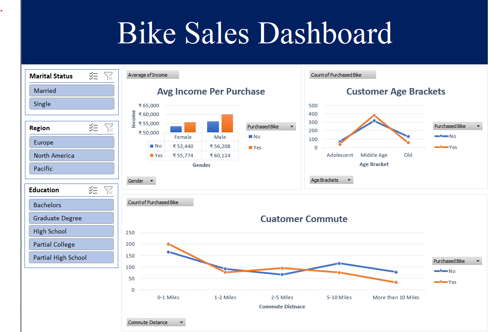
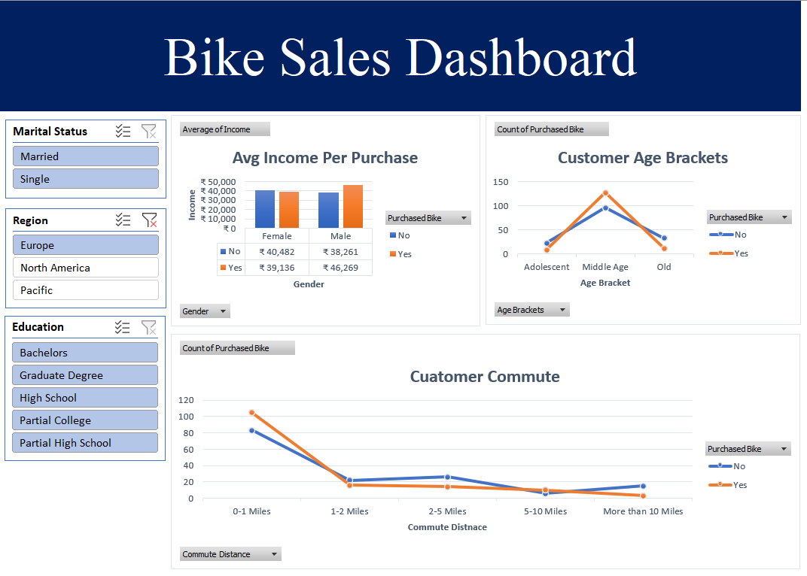
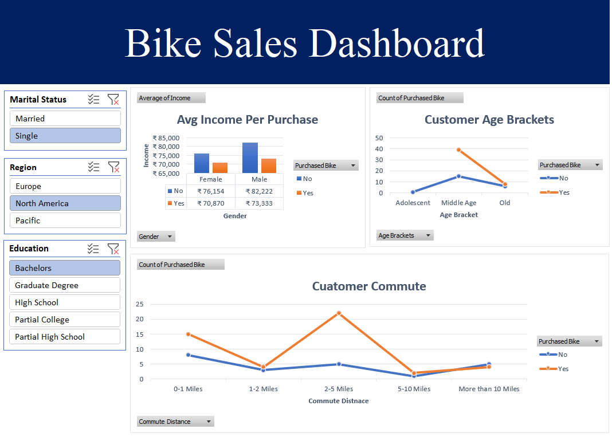

# Bike Sales Dashboard

An interactive Excel dashboard exploring customer demographics and bike purchase patterns.

## Dashboard screenshots

**Overview**

*All slicers are cleared, showing the full dataset.*

**Filtered view 1**

*Region: Europe. Marital Status and Education are unfiltered.*

**Filtered view 2**

*Region: North America · Marital Status: Single · Education: Bachelors.*

## Project overview

This project takes the Bike Buyers dataset from raw data through cleaning and PivotTable analysis to an interactive Excel dashboard. It explores average income and bike purchase counts across customer groups.

## Workbook

Download [`bike-sales-dashboard.xlsx`](workbook/bike-sales-dashboard.xlsx) and open it in Microsoft Excel to explore the dashboard and use its slicers.

| Sheet | Purpose |
| --- | --- |
| `bike_buyers` | Original source data (1,026 rows), retained for reference. |
| `Working Sheet` | Cleaned dataset used for the analysis (1,000 rows). |
| `Pivot Table` | PivotTable summaries. |
| `Dashboard` | Three charts with slicers for marital status, region, and education. |

## Data preparation

The working sheet was prepared in Excel by:

- Removing 26 duplicate customer IDs, reducing the dataset from 1,026 to 1,000 rows.
- Replacing abbreviated marital-status and gender values with full labels.
- Adding age brackets: `Adolescent 0-30`, `Middle Age 31-54`, and `Old 55+`.

## Dashboard analysis

The dashboard compares average income by gender and purchase outcome, and shows bike purchase counts by age bracket and commute distance. The charts use counts for age and commute groups, so they do not by themselves show which group is more likely to purchase. This is a descriptive analysis and does not establish cause and effect.

## Tools used

Microsoft Excel · data cleaning · duplicate removal · value standardization · age grouping with IF · PivotTables · PivotCharts · slicers · dashboard design

## Dataset credit

The Bike Buyers dataset is shared in [Alex The Analyst’s Excel-Tutorial repository](https://github.com/AlexTheAnalyst/Excel-Tutorial). The source repository does not specify a dataset license. Please check the reuse terms before making the workbook public.

